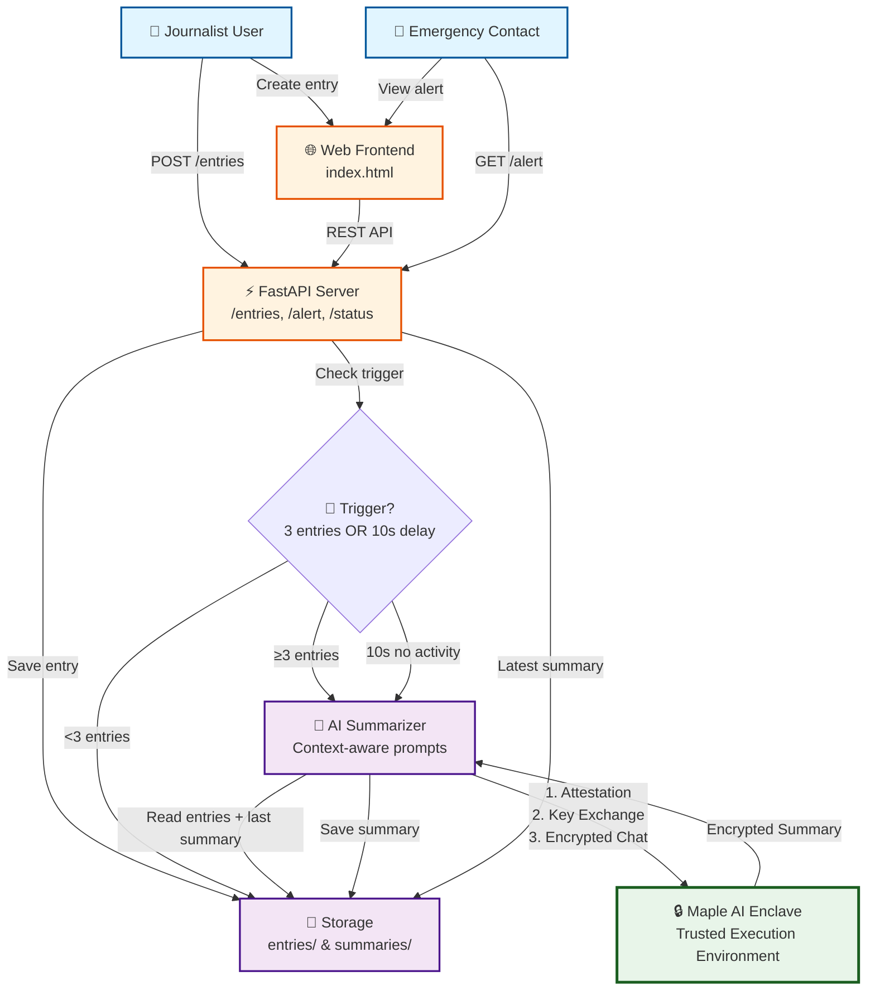

# Safe Journalist - High-Level Flow Diagram

This diagram provides a bird's-eye view of how the Safe Journalist application works, from user interaction to AI-powered summarization.

## Key Components

### 👤 Users
- **Journalist**: Creates entries (text/audio) via web or API
- **Emergency Contact**: Views alerts and summaries when needed

### 🌐 Interface
- **Web Frontend**: Simple, mobile-responsive UI (`index.html`)
- **FastAPI Server**: REST endpoints for entries, alerts, status

### 💾 Storage
- **Entries**: Timestamped markdown files in `data/entries/`
- **Summaries**: AI-generated summaries in `data/summaries/`

### 🎯 Trigger System
- **Count-based**: Triggers after 3 entries (configurable)
- **Time-based**: Triggers after 10s of inactivity (configurable)
- Whichever fires first wins, other is cancelled

### 🤖 AI Summarizer
- Reads previous summary + new entries for context
- Generates 3-5 bullet actionable summary
- All communication encrypted end-to-end

### 🔒 Maple AI Enclave
- **Attestation**: Verifies enclave identity
- **Key Exchange**: Establishes session keys
- **Encrypted Chat**: Processes requests in Trusted Execution Environment (TEE)

## Flow Summary

1. **User creates entries** → API saves to disk
2. **Trigger system** monitors count (3 entries) or time (10s inactivity)
3. **When triggered** → Summarizer reads context (previous summary + new entries)
4. **Secure AI call** → End-to-end encrypted with Maple AI enclave (attestation → key exchange → encrypted chat)
5. **Summary saved** → Emergency contacts can access latest alert via web or API

## Security Model

All AI communication uses:
- ChaCha20-Poly1305 symmetric encryption
- Session keys negotiated via Diffie-Hellman
- Only encrypted data transmitted over network
- AI processing in Trusted Execution Environment (TEE)

See [ARCHITECTURE.md](ARCHITECTURE.md) for detailed technical diagrams and implementation details.
