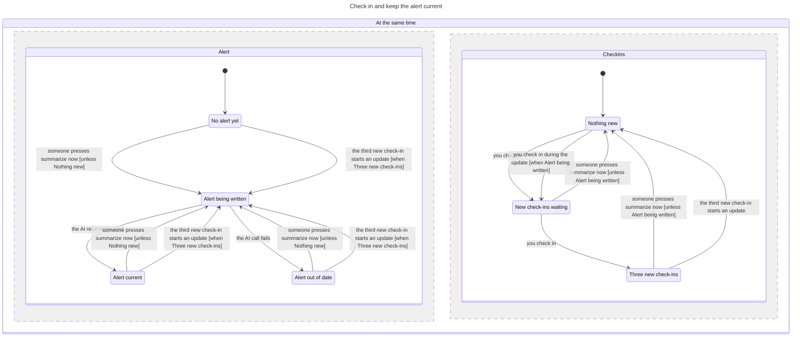

# Check-in coverage verification

| Skill | What it checks | Tool |
| --- | --- | --- |
| [verify-check-in-coverage](../../.claude/skills/verify-check-in-coverage/SKILL.md) | Every check-in is stored and reaches an emergency summary | TLA+ / TLC, 1,499 states, plus `tests/test_entry_coverage.py` |

The model found two ways a check-in could miss the emergency contacts, now fixed:

1. Two check-ins in the same second had the same file name, so the second replaced the first (50f7e3f).
2. A check-in written while a summary was being generated was older than that summary's name, so no summary ever included it (ea136bc).

## Check in and keep the alert current

Generated with pstack `/statechart` from [CheckIn.tla](flows/check-in/CheckIn.tla) ([TLC report](flows/check-in/report.md)). The alert and the waiting check-ins are parallel regions.

